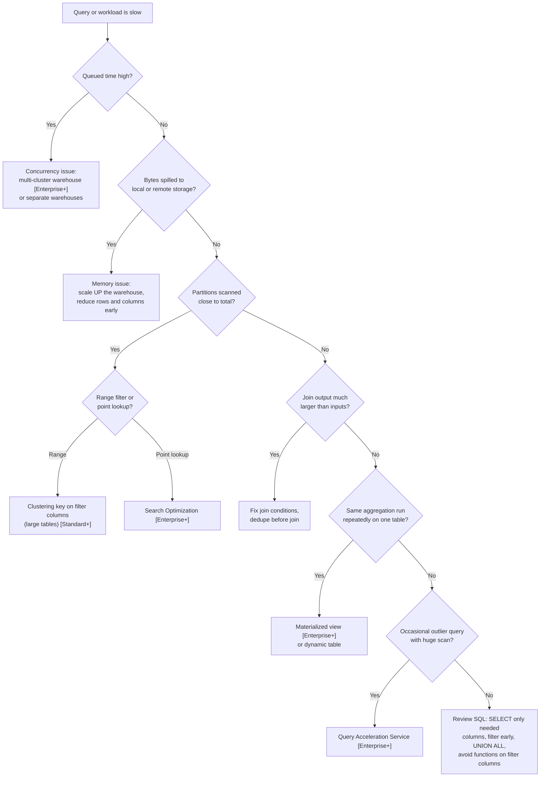

# 10 — Performance and Cost

**Exam domain:** 3 (Performance Concepts, 15%). Cost topics also appear in domain 1.

## 10.1 Query Profile

The **Query Profile** (Snowsight → Query History → a query → Query Profile) shows the execution plan as a tree of **operator nodes**, with statistics for each node.

### Panels and what to look for

| Panel / statistic | What it tells you | Typical fix |
|---|---|---|
| **Most expensive nodes** | Operators that took the largest share of time | Focus tuning there |
| **Profile overview** | Share of time in Processing, Local Disk I/O, Remote Disk I/O, Network Communication, Synchronization, Initialization | High remote I/O suggests large scans or poor pruning |
| **Partitions scanned vs Partitions total** (TableScan) | Pruning efficiency | Clustering key, better predicates, search optimization |
| **Bytes spilled to local storage** | Memory overflowed to the warehouse SSD | Scale up, or reduce the data processed |
| **Bytes spilled to remote storage** | SSD overflowed to cloud storage, which is **very slow** | **Scale up** (bigger warehouse), or break up the query |
| **Percentage scanned from cache** | Warehouse (local disk) cache hits | Keep the warehouse warm, and group similar workloads |
| **Join: output rows ≫ input rows** | **Exploding join** (bad or missing join condition, many-to-many) | Fix the join keys, deduplicate first |
| **UNION** where **UNION ALL** would do | An extra duplicate-elimination aggregate | Use `UNION ALL` when duplicates are impossible or acceptable |
| **Query result reuse** node | Served from the result cache | (good) |
| **Queued time** (in query details) | Waiting for warehouse resources | Multi-cluster, or a separate warehouse |

Common operators: `TableScan`, `Filter`, `Join`, `Aggregate`, `Sort`, `SortWithLimit` (Top-K), `WindowFunction`, `Flatten`, `ExternalScan`, `Insert`, `Result`, `WithClause`, `CartesianJoin`.

> **Exam trap:** **Remote spilling** is the classic sign that a warehouse is **too small**. The fix is to scale **up**, not out.

> **Exam trap:** A `CartesianJoin` operator, or join output far larger than its inputs, points to an **exploding join**. A bigger warehouse won't fix the logic.

Programmatic alternatives:

```sql
SELECT * FROM TABLE(GET_QUERY_OPERATOR_STATS(LAST_QUERY_ID()));
EXPLAIN SELECT ...;           -- plan without executing (uses compile-time info)
```

## 10.2 Tuning decision tree



The same tree as a table:

| Symptom | Root cause | Fix |
|---|---|---|
| Queries **queue** at peak times | Concurrency | Multi-cluster [Enterprise+], separate warehouses per workload |
| **Spilling** | Not enough memory for joins, sorts, aggregations | Bigger warehouse; process fewer rows or columns |
| Scan of most partitions | Poor pruning | Clustering key; rewrite predicates; search optimization for lookups |
| **Exploding join** | Logic | Correct the join conditions |
| Repeated identical query | | Rely on the result cache; don't disable it |
| Repeated expensive aggregation | | Materialized view or dynamic table |
| Rare, unpredictable heavy queries | | Query Acceleration Service |
| First query after resume is slow | Cold warehouse cache | Longer auto-suspend for BI warehouses |

## 10.3 Query Acceleration Service [Enterprise+]

- **Offloads parts of eligible queries**, mainly large scans with filters and aggregations, to shared serverless compute.
- Enable it per warehouse with `ENABLE_QUERY_ACCELERATION = TRUE`. `QUERY_ACCELERATION_MAX_SCALE_FACTOR` (default **8**, where 0 means no limit) caps the extra compute as a multiple of the warehouse size.
- Find candidates with `SYSTEM$ESTIMATE_QUERY_ACCELERATION('<query_id>')` and the `QUERY_ACCELERATION_ELIGIBLE` view.
- Billed as **serverless credits**.

> **Exam trap:** QAS helps **outlier** queries on an otherwise right-sized warehouse. It's **not** a fix for concurrency (use multi-cluster) or for complex joins (scale up).

## 10.4 Cost model

| Cost component | How it's measured | Notes |
|---|---|---|
| **Virtual warehouse compute** | Credits/hour × uptime, per second, 60 s minimum on each start | See chapter 2 |
| **Serverless compute** | Credits, per feature | Snowpipe, Automatic Clustering, MV maintenance, search optimization, serverless tasks, QAS, replication, and others. Each has its own multiplier. |
| **Cloud services** | Credits | Billed only above **10%** of daily warehouse credits |
| **Storage** | Average compressed TB per month | Includes Time Travel, Fail-safe, and internal stages |
| **Data transfer** | Per byte | **Egress** cross-region or cross-cloud, and unloading to another region. **Ingress is free.** |

- The **price per credit** depends on **edition, cloud, and region**.
- **On-demand** pricing is pay-as-you-go. **Capacity** pricing is a pre-purchased commitment at a discount.
- Cost visibility: Snowsight **Cost Management**, `WAREHOUSE_METERING_HISTORY`, `METERING_DAILY_HISTORY`, `METERING_HISTORY`, and `ORGANIZATION_USAGE` views.

> **Exam trap:** **Resource monitors only track user-managed warehouses.** They don't stop serverless features or cloud services. Use **budgets** to monitor serverless and overall spend.

## 10.5 Resource monitors [Standard+]

```sql
USE ROLE ACCOUNTADMIN;
CREATE RESOURCE MONITOR rm_monthly WITH
  CREDIT_QUOTA = 100
  FREQUENCY = MONTHLY
  START_TIMESTAMP = IMMEDIATELY
  TRIGGERS ON 75 PERCENT DO NOTIFY
           ON 90 PERCENT DO SUSPEND
           ON 100 PERCENT DO SUSPEND_IMMEDIATE;

ALTER WAREHOUSE etl_wh SET RESOURCE_MONITOR = rm_monthly;   -- warehouse-level
ALTER ACCOUNT SET RESOURCE_MONITOR = rm_account;            -- account-level
```

| Property | Detail |
|---|---|
| Created by | **ACCOUNTADMIN** only. ACCOUNTADMIN can grant `MONITOR` / `MODIFY` on a monitor to other roles. |
| Scope | **Account** (one per account) or **warehouse** level (one monitor can cover many warehouses, but **each warehouse has at most one** monitor) |
| `CREDIT_QUOTA` | Credits allowed per interval |
| `FREQUENCY` | `DAILY`, `WEEKLY`, `MONTHLY`, `YEARLY`, `NEVER` |
| Triggers (actions) | `NOTIFY`; `SUSPEND` (lets **running queries finish**, then suspends); `SUSPEND_IMMEDIATE` (**cancels running queries** and suspends) |
| Thresholds | Percent of quota; can go above 100 (for example 110%) |
| Reset | Usage resets at the start of each interval. Suspended warehouses can't be resumed until the interval resets, the quota is raised, or the warehouse is removed from the monitor. |
| Notifications | Go to account administrators who enabled them, and to non-admin users added to the monitor's notification list |

> **Exam trap:** A warehouse-level monitor **doesn't** override the account-level monitor. Both apply, and whichever triggers first wins.

> **Exam trap:** `SUSPEND` waits for running queries to complete, so credit use can **exceed** the quota slightly. Use `SUSPEND_IMMEDIATE` for a hard stop.

### Budgets

**Budgets** set a monthly spending limit and send notifications. They can cover the **whole account**, including **serverless features**, or a custom group of objects. They notify, but don't suspend anything.

## 10.6 Cost and performance best practices

| Area | Practice |
|---|---|
| Warehouses | Separate warehouses by workload (ETL, BI, data science); set auto-suspend; right-size by testing; watch queuing and spilling |
| Queries | Select only needed columns, filter early, avoid `SELECT *` on wide tables, use `UNION ALL`, and use `LIMIT` with `ORDER BY` for Top-K |
| Caching | Leave `USE_CACHED_RESULT` on; reuse BI query text; schedule related queries together for warehouse-cache hits |
| Storage | Use transient tables for rebuildable data; reduce Time Travel retention on high-churn staging tables; drop unused clones |
| Loading | Use files of 100–250 MB; use Snowpipe for continuous loads rather than an always-on warehouse |
| Governance | Resource monitors on every warehouse; budgets for serverless; `QUERY_TAG` for cost attribution; timeouts (`STATEMENT_TIMEOUT_IN_SECONDS`) |

## Self-check

**1. A query shows large "Bytes spilled to remote storage". What's the best first fix?**
<details><summary>Answer</summary>Run it on a <b>larger warehouse</b> (scale up), and reduce the data it processes where you can.</details>

**2. Which resource monitor action cancels running queries?**
<details><summary>Answer</summary><b>SUSPEND_IMMEDIATE</b>. SUSPEND lets running queries finish.</details>

**3. Can a resource monitor stop Snowpipe or Automatic Clustering spend?**
<details><summary>Answer</summary>No. Resource monitors only control user-managed warehouses. Use budgets to monitor serverless spend.</details>

**4. Which role can create resource monitors?**
<details><summary>Answer</summary><b>ACCOUNTADMIN</b>.</details>

**5. How many resource monitors can be assigned to one warehouse?**
<details><summary>Answer</summary><b>One</b>. An account-level monitor can also apply to the account as a whole.</details>

**6. Partitions scanned = 9,800 of 10,000 for a date-range query on a 6 TB table. What should you consider?**
<details><summary>Answer</summary>Pruning is poor. Consider a <b>clustering key</b> on the date column (or a date expression), and check that the predicate doesn't wrap the column in a function.</details>
